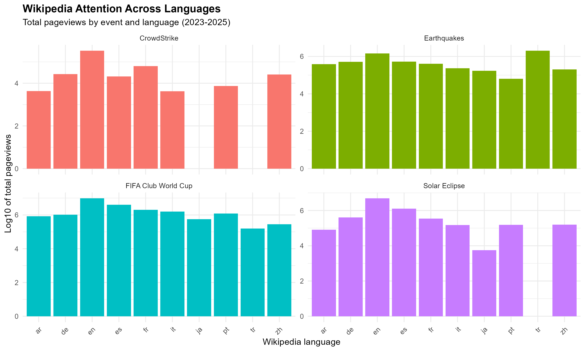

# THE INTERNET'S MEMORY

### Multilingual Analysis of Global Attention Through Wikipedia Pageviews (2023–2025)

**Author:** Fedi Arfaoui  
**Institution:** ESSAI — École Supérieure de la Statistique et de l'Analyse de l'Information  
**Academic Year:** 2026–2027

## 1. Project Overview

This project explores how global events attract public attention across different Wikipedia language editions.

Using daily Wikipedia pageview data, the study investigates differences in information-seeking behavior and the evolution of attention over time.

**Research question:**

Do linguistic communities exhibit similar levels of interest in major global events, and how does this interest evolve over time?

## 2. Dataset

Data sources:
- Wikimedia Pageviews API
- MediaWiki Action API

Study period: 2023–2025.

The dataset contains:
- 4 international events
- 10 Wikipedia language editions
- 37 validated articles
- 33,800 daily pageview observations

Languages: Arabic, English, French, Spanish, German, Italian, Portuguese, Turkish, Japanese and Chinese.

## 3. Events Analyzed

| Event | Date |
|---|---|
| Turkey–Syria earthquakes | February 6, 2023 |
| Solar eclipse | April 8, 2024 |
| CrowdStrike outage | July 19, 2024 |
| FIFA Club World Cup | June–July 2025 |

## 4. Methodology

The analysis follows these steps:

1. Identification and validation of Wikipedia articles.
2. Collection of daily pageviews.
3. Data cleaning and validation.
4. Exploratory data analysis using R.
5. Comparison across language editions.
6. Calculation of a relative Attention Index.
7. Data visualization using ggplot2.

### Attention Index

Attention Index =

(Mean daily views during event / Mean daily views during baseline) × 100

The baseline covers 28 days before the event.

An index above 100 indicates increased attention relative to the baseline.

The index is calculated only when both observation windows are complete.

## 5. Main Findings

- Attention patterns differ across events and Wikipedia language editions.
- Sudden crises tend to generate sharp peaks in pageviews.
- Extended sporting events produce fluctuations over longer periods.
- All 18 articles with complete observation windows have an Attention Index above 100.
- The highest observed Attention Index for the solar eclipse is 625 (Chinese Wikipedia).
- The highest observed Attention Index for the FIFA Club World Cup is 299 (Spanish Wikipedia).

These results describe Wikipedia pageview activity, not the nationality or geographic location of readers.

## 6. Visualizations

### Pageviews by Event and Language



### Attention Index Across Languages


### Evolution of Attention Over Time


## 7. Repository Structure

```text
The-Internets-Memory/
|
|-- 01_validation_articles.R
|-- 02_collect_pageviews.R
|-- exploratory_analysis.R_03.R
|
|-- articles_all.csv
|-- pageviews_all.csv
|-- pageviews_status.csv
|-- coverage_windows.csv
|-- attention_index.csv
|-- views_by_event_language.csv
|
|-- figures/
|   |-- plot1_language_attention.png
|   |-- plot2_attention_index.png
|   |-- plot3_event_evolution.png
|
|-- The_Internets_Memory_Poster_A0.pdf
|-- README.md
```

## 8. Tools and Technologies

- R
- tidyverse
- ggplot2
- Wikimedia APIs
- LaTeX / Overleaf
- GitHub

## 9. Reproducibility

The R scripts are organized into three stages:

1. `01_validation_articles.R` — Article validation.
2. `02_collect_pageviews.R` — Pageview collection.
3. `exploratory_analysis.R_03.R` — Exploratory analysis and visualization.

Run the scripts in this order from the project directory, with the required R packages installed.

The repository also contains the collected CSV files, allowing the analysis to be examined without repeating all API requests.

API availability and rate limits may affect a fresh data collection.

## 10. Limitations

- Wikipedia language editions do not directly identify readers' nationalities.
- Raw pageview totals are influenced by audience size.
- Some articles have incomplete observation windows.
- The Attention Index is available only for articles with complete baseline and event windows.

## 11. AI Usage Declaration

**Estimated AI usage: 65%.**

ChatGPT was used to assist with R programming, debugging, exploratory analysis and LaTeX poster preparation.

The study uses data collected from Wikimedia APIs.

## 12. Scientific Poster

The scientific poster is provided as a one-page A0 PDF in this repository.

---

**Author:** Fedi Arfaoui  
**ESSAI — Academic Year 2026–2027**
