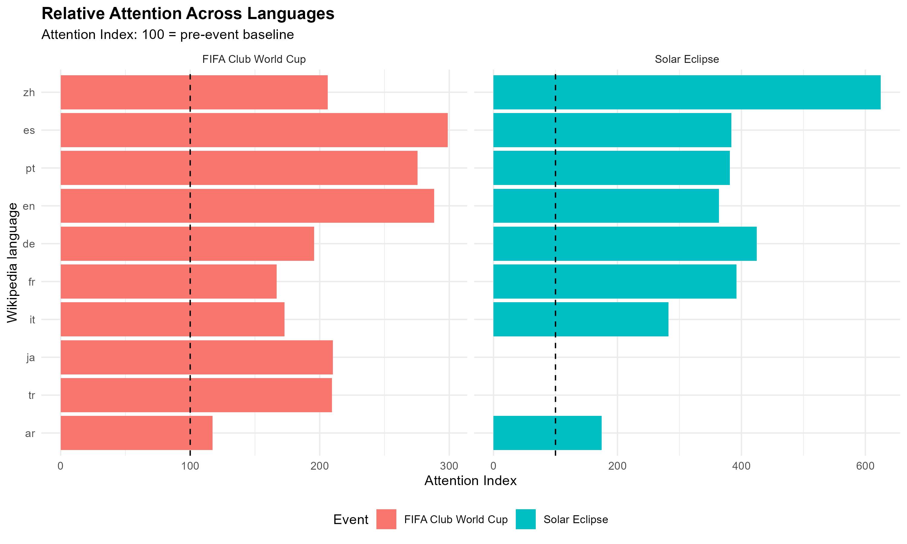
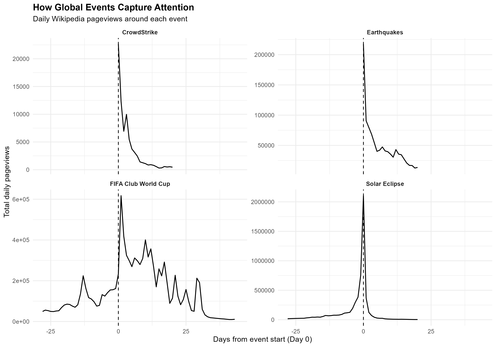

# THE INTERNET'S MEMORY

### Analyse multilingue de l'attention mondiale à travers les consultations de Wikipédia (2023–2025)

**Auteur :** Fedi Arfaoui  
**Établissement :** ESSAI — École Supérieure de la Statistique et de l'Analyse de l'Information  
**Année universitaire :** 2026–2027

---

## 1. Présentation du projet

**The Internet's Memory** est un projet d'analyse exploratoire de données (EDA) qui étudie l'évolution de l'attention mondiale à travers les consultations quotidiennes de Wikipédia.

L'objectif est de comprendre comment différents événements internationaux attirent l'attention des lecteurs et comment cette attention varie entre les éditions linguistiques.

### Problématique

Les communautés linguistiques manifestent-elles le même niveau d'intérêt pour les grands événements mondiaux, et comment cet intérêt évolue-t-il dans le temps ?

## 2. Données utilisées

**Sources :**
- Wikimedia Pageviews API
- MediaWiki Action API

**Période étudiée :** 2023–2025

| Indicateur | Valeur |
|---|---|
| Événements internationaux | 4 |
| Éditions linguistiques | 10 |
| Articles Wikipédia | 37 |
| Observations quotidiennes | 33 800 |
| Valeurs manquantes | 0 |
| Observations dupliquées | 0 |

### Langues étudiées

Arabe (AR), anglais (EN), français (FR), espagnol (ES), allemand (DE), italien (IT), portugais (PT), turc (TR), japonais (JA) et chinois (ZH).

## 3. Événements analysés

| Événement | Date |
|---|---|
| Séismes Turquie–Syrie | 6 février 2023 |
| Éclipse solaire | 8 avril 2024 |
| Panne CrowdStrike | 19 juillet 2024 |
| Coupe du monde des clubs FIFA | Juin–juillet 2025 |

## 4. Méthodologie

Le projet suit les étapes suivantes :

1. Identification et validation des articles Wikipédia.
2. Collecte des consultations quotidiennes.
3. Nettoyage et contrôle de qualité des données.
4. Analyse exploratoire avec R et tidyverse.
5. Comparaison des éditions linguistiques.
6. Calcul d'un indice d'attention.
7. Création des visualisations avec ggplot2.

### Indice d'attention

L'indice d'attention compare les consultations moyennes pendant un événement aux consultations moyennes pendant une période de référence.

**IA = (Moyenne événement / Moyenne référence) × 100**

La période de référence correspond aux 28 jours précédant l'événement.

- IA = 100 : niveau de référence.
- IA > 100 : augmentation de l'attention.
- IA < 100 : diminution de l'attention.

L'indice est calculé uniquement lorsque les deux fenêtres temporelles sont complètes.

## 5. Principaux résultats

L'analyse a mis en évidence plusieurs résultats :

- Les événements produisent des dynamiques d'attention différentes.
- Les crises soudaines présentent généralement des pics de consultations concentrés.
- Les compétitions sportives prolongées présentent des fluctuations sur plusieurs semaines.
- 18 articles disposent de fenêtres complètes pour calculer l'indice d'attention.
- Ces 18 articles présentent tous un indice supérieur à 100.

### Résultats de l'indice d'attention

| Événement | Langue | Indice |
|---|---|---|
| Éclipse solaire | Chinois (ZH) | 625 |
| Éclipse solaire | Arabe (AR) | 175 |
| Coupe du monde des clubs FIFA | Espagnol (ES) | 299 |
| Coupe du monde des clubs FIFA | Arabe (AR) | 117 |

Ces résultats décrivent les consultations des éditions linguistiques de Wikipédia et ne permettent pas d'identifier directement la nationalité des lecteurs.

## 6. Visualisations

### Figure 1 — Consultations par événement et langue


### Figure 2 — Indice d'attention



### Figure 3 — Évolution temporelle



## 7. Structure du projet

```text
The-Internets-Memory/
|
|-- 01_validation_articles.R
|-- 02_collect_pageviews.R
|-- exploratory_analysis.R_03.R
|-- The-Internet-Memory.Rproj
|
|-- articles_all.csv
|-- pageviews_all.csv
|-- pageviews_status.csv
|-- coverage_windows.csv
|-- attention_index.csv
|-- views_by_event_language.csv
|
|-- figures/
|   |-- plot1_language_attention.png
|   |-- plot2_attention_index.png
|   |-- plot3_event_evolution.png
|
|-- The_Internet_s_Memory___A0_Poster (6).pdf
|-- README.md
```

## 8. Outils et technologies

- R
- tidyverse
- ggplot2
- Wikimedia APIs
- LaTeX / Overleaf
- RStudio
- GitHub

## 9. Reproductibilité

### Ouvrir le projet

1. Télécharger le dépôt GitHub.
2. Ouvrir `The-Internet-Memory.Rproj` dans RStudio.
3. Installer les packages R nécessaires, si besoin.
4. Exécuter les scripts depuis le dossier du projet.

### Scripts

**Script 01 :**
`01_validation_articles.R`

Validation des articles Wikipédia.

**Script 02 :**
`02_collect_pageviews.R`

Collecte des données à partir des API Wikimedia.

**Script 03 :**
`exploratory_analysis.R_03.R`

Analyse exploratoire, calcul des indicateurs et création des graphiques.

### Reproduire les visualisations

Les fichiers CSV collectés sont déjà inclus dans le dépôt.

Dans la Console RStudio :

```r
source("exploratory_analysis.R_03.R")
```

Le script produit les trois visualisations dans le dossier `figures/` et exporte les tableaux d'analyse.

Une nouvelle collecte via les API peut être affectée par les limitations de requêtes et la disponibilité des services Wikimedia.

## 10. Limites de l'étude

- La langue d'une édition Wikipédia ne représente pas nécessairement la nationalité des lecteurs.
- Les volumes bruts ne sont pas directement comparables entre audiences linguistiques.
- Certains articles présentent des fenêtres temporelles incomplètes.
- L'indice d'attention est calculé uniquement pour les articles disposant des données nécessaires.

## 11. Utilisation de l'intelligence artificielle

**Taux estimé d'utilisation de l'IA : 65 %.**

ChatGPT a été utilisé comme outil d'assistance pour :

- La programmation R.
- Le débogage.
- L'analyse exploratoire des données.
- La préparation du poster scientifique en LaTeX.

Les données proviennent des API Wikimedia.

## 12. Poster scientifique A0

Le poster scientifique a été réalisé avec LaTeX et présenté au format A0, sur une seule page.

### [Consulter le poster scientifique A0 (PDF)](The_Internet_s_Memory___A0_Poster%20%286%29.pdf)

Le poster présente la problématique, la méthodologie, les trois visualisations, les résultats, les limites et les conclusions de l'étude.

---

**Fedi Arfaoui**  
**ESSAI — École Supérieure de la Statistique et de l'Analyse de l'Information**  
**Année universitaire 2026–2027**

